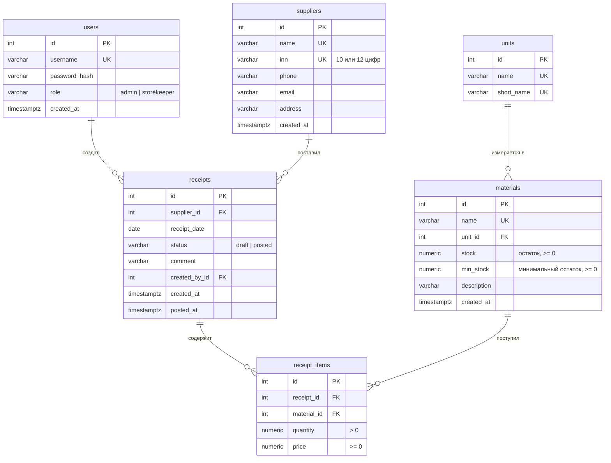

# Схема данных

СУБД: PostgreSQL 16+. Таблицы описаны моделями в `app/models/`, а создаются и изменяются миграциями Alembic из `migrations/versions/` (`make migrate`).

## Таблицы

### users — пользователи

| Поле | Тип | Ограничения |
|---|---|---|
| id | integer | PK |
| username | varchar(50) | уникальное |
| password_hash | varchar(100) | хеш bcrypt, пароль в открытом виде не хранится |
| role | varchar(20) | `admin` или `storekeeper` (CHECK) |
| created_at | timestamptz | по умолчанию now() |

### units — единицы измерения

| Поле | Тип | Ограничения |
|---|---|---|
| id | integer | PK |
| name | varchar(50) | уникальное, «Килограмм» |
| short_name | varchar(10) | уникальное, «кг» |

### materials — материалы

| Поле | Тип | Ограничения |
|---|---|---|
| id | integer | PK |
| name | varchar(200) | уникальное |
| unit_id | integer | FK → units.id |
| stock | numeric(12,3) | остаток на складе, ≥ 0 (CHECK), по умолчанию 0 |
| min_stock | numeric(12,3) | минимальный остаток, ≥ 0 (CHECK), по умолчанию 0 — не отслеживать; если `stock < min_stock`, материал попадает в список «К заказу» |
| description | varchar(500) | необязательное |
| created_at | timestamptz | по умолчанию now() |

### suppliers — поставщики

| Поле | Тип | Ограничения |
|---|---|---|
| id | integer | PK |
| name | varchar(200) | уникальное |
| inn | varchar(12) | уникальное, 10 или 12 цифр |
| phone, email, address | varchar | необязательные |
| created_at | timestamptz | по умолчанию now() |

### receipts — поступления (документы)

| Поле | Тип | Ограничения |
|---|---|---|
| id | integer | PK, номер поступления |
| supplier_id | integer | FK → suppliers.id |
| receipt_date | date | дата поступления, индекс `ix_receipts_receipt_date` (список сортируется по дате) |
| status | varchar(10) | `draft` (черновик) или `posted` (проведено), CHECK |
| comment | varchar(500) | необязательное |
| created_by_id | integer | FK → users.id |
| created_at | timestamptz | по умолчанию now() |
| posted_at | timestamptz | время проведения, пусто у черновика |

### receipt_items — строки поступления

| Поле | Тип | Ограничения |
|---|---|---|
| id | integer | PK |
| receipt_id | integer | FK → receipts.id, ON DELETE CASCADE |
| material_id | integer | FK → materials.id, индекс `ix_receipt_items_material_id` (проверка при удалении материала) |
| quantity | numeric(12,3) | > 0 (CHECK) |
| price | numeric(12,2) | цена за единицу, ≥ 0 (CHECK) |

Пара (`receipt_id`, `material_id`) уникальна: материал встречается в поступлении один раз.

## Миграции

| Ревизия | Файл | Что меняет |
|---|---|---|
| 0001 | `0001_initial.py` | начальная схема: все таблицы версий 0.1–0.2 |
| 0002 | `0002_material_min_stock.py` | поле `materials.min_stock` и ограничение `ck_materials_min_stock` |
| 0003 | `0003_receipt_indexes.py` | индексы `ix_receipts_receipt_date` и `ix_receipt_items_material_id` |

Каждая миграция ссылается на предыдущую (`down_revision`) и умеет откатываться (`downgrade`). Номер текущей ревизии хранится в таблице `alembic_version`. Базы, созданные версиями 0.1–0.2 без миграций, при первом `make migrate` отмечаются ревизией 0001 и обновляются дальше (`app/migrate.py`).

## Как связаны остатки и поступления

`materials.stock` меняется только в одном месте — при проведении поступления (`app/services/receipts.py`, функция `post_receipt`):

1. строка поступления блокируется (`SELECT ... FOR UPDATE`), чтобы два одновременных запроса не провели его дважды;
2. для каждой строки выполняется `UPDATE materials SET stock = stock + quantity`;
3. статус меняется на `posted`, всё фиксируется одной транзакцией.

Внешние ключи без каскадного удаления не дают удалить единицу измерения, материал или поставщика, на которые ссылаются другие записи.
